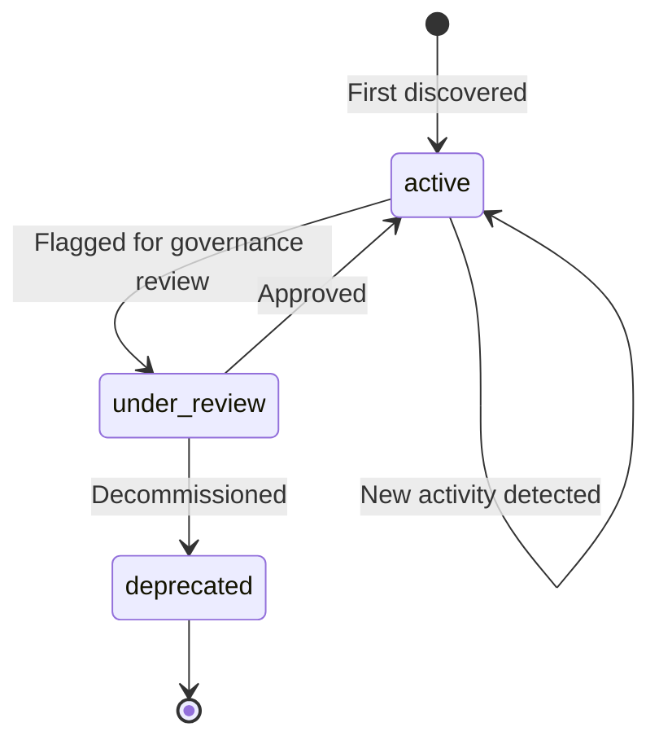

# AI Asset Registry

The AI Asset Registry is the central data store for all discovered AI usage across your organization. Every AI use case — whether found by a browser extension, SDK, gateway, or platform signal — becomes an **AI Asset** in the registry.

## What is an AI Asset?

An AI Asset represents a **specific AI use case** within a business unit. It's the combination of:

- **Who** is using AI (business unit + owner)
- **What** AI they're using (vendor + model)
- **Why** they're using it (use case name)
- **Where** it runs (environment)

**Example:** "HR department using OpenAI GPT-4o for interview screening in production" is one AI Asset.

## Asset Granularity

One row per unique combination of `(vendor, model, use_case_name, business_unit, environment)` within a tenant.

This means:
- HR using GPT-4o for screening = **Asset A**
- Legal using GPT-4o for contracts = **Asset B** (different use case + BU)
- HR using GPT-4o for screening in staging = **Asset C** (different environment)

## Asset Lifecycle



### Stale and retired assets

Separately from the governance `status` above, every asset has a
telemetry-driven `lifecycle_state`:

| State | Meaning |
|-------|---------|
| `active` | Seen within the asset's stale threshold |
| `stale` | Not seen for the stale threshold |
| `retired` | Not seen for the retire threshold, or retired by its owner |

Discovery sources report on different cadences, so the thresholds (days) are
set per source:

| Source | Stale after | Retired after | Why |
|--------|-------------|---------------|-----|
| `platform_signal` | 7 | 30 | Cloud inventory and provider usage pulls refresh daily |
| `code_scan` | 90 | 180 | Runs only on CI; repositories can sit unchanged for months |
| `survey` | 180 | 365 | Self-reported, rarely repeated |
| any other, including `sdk`, `gateway`, `otel`, `browser_extension`, `macos_app` | `PS_ASSET_STALE_AFTER_DAYS` (30) | `PS_ASSET_RETIRE_AFTER_DAYS` (90) | Same as before per-source thresholds; a batch job that runs monthly stays active |

Override single sources with `PS_ASSET_LIFECYCLE_SOURCE_THRESHOLDS`, e.g.
`code_scan=60:120,sdk=14:60` (stale:retire days; the collector refuses to
start on a malformed value).

An asset seen by several sources is judged by its most recent sighting from
any of them (`last_seen`) against the **most lenient** threshold among its
sources. The collector does not record which source saw an asset last, so a
stricter rule would mark an asset stale between two on-schedule runs of its
slowest source. The trade-off: when only the fast source stops seeing such
an asset, it goes stale later.

New telemetry for a stale or retired asset makes it `active` again. Filter with
`?lifecycle_state=stale` on the asset list endpoints; the delta feed
(`/partner/v1/changes`) reports transitions in `lifecycle_change`
(`stale`, `retired`, `reactivated` or `retired_in_use`).

#### Owner-initiated retirement

An owner retires an asset with an `asset` attestation in state `retired`
(`POST /api/v1/registry/assets/{id}/attestations` or the Partner API
equivalent). The asset becomes `retired`, `retired_by` records who and
`lifecycle_changed_at` when, and an `asset.retired` webhook is sent. The
sweep leaves it alone and new telemetry does **not** reactivate it. Instead,
the first sighting afterwards sets `retired_in_use_at` ("retired asset still
in use"): the delta feed reports `lifecycle_change: retired_in_use` and an
`asset.changed` webhook names `retired_in_use_at`. Later sightings do not
raise it again until the owner acts:

- retire it again (another `retired` attestation) to acknowledge the use;
  this clears `retired_in_use_at`, so the next sighting raises it again;
- or un-retire it with an `asset` attestation in state `attested` or
  `unreviewed`: `retired_by` is cleared and the asset goes to the state its
  `last_seen` calls for (`asset.changed` if that differs).

`disputed` (the asset record is wrong) does not un-retire it, and retiring
or attesting a single field (for example `owner`) neither retires nor
un-retires the asset. Two sightings at the same moment raise "still in use"
once.

The collector does not schedule the lifecycle sweep itself. Run it periodically,
for example daily from cron or a Kubernetes CronJob:

```bash
python -m collector.lifecycle            # all tenants, per-source thresholds
python -m collector.lifecycle --stale-after-days 14 --retire-after-days 60  # one threshold for every source
```

A tenant admin can also sweep their own tenant with
`POST /api/v1/admin/asset-lifecycle/sweep` (optional `stale_after_days` and
`retire_after_days` query parameters, which likewise apply to every source).
The response lists the per-source thresholds it used in `source_thresholds`.

## Key Fields

| Field | Description | Example |
|-------|-------------|---------|
| `vendor` | AI provider | `openai`, `anthropic`, `google` |
| `model` | Specific model | `gpt-4o`, `claude-sonnet-4-20250514` |
| `use_case_name` | Business purpose | `interview-screening` |
| `business_unit` | Org unit | `HR`, `Legal`, `Engineering` |
| `owner_email` | Responsible person | `jane.doe@acme.com` |
| `data_classification` | Data sensitivity | `confidential` |
| `discovery_source` | How it was found | `["sdk", "browser_extension"]` |
| `confidence` | Discovery certainty | `verified` |
