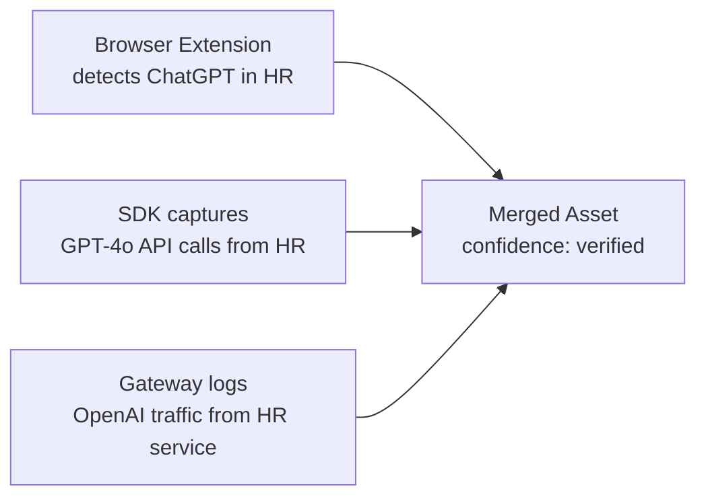

# Discovery Sources

Prompt Shields uses multiple independent channels to discover AI usage. When the same AI system is detected by multiple sources, confidence increases.

## Discovery Channels

| Source | What It Catches | How It Works |
|--------|----------------|--------------|
| **Browser Extension** | Shadow AI (ChatGPT, Gemini, Copilot in browser) | Chrome, Safari, Edge extensions monitor AI tool usage |
| **macOS App** | System-level AI tool usage | Accessibility-based tracking across all applications |
| **SDK** | Developer API calls with rich business context | Drop-in OpenAI wrapper captures metadata |
| **Gateway** | All LLM API traffic (zero code change) | Proxy intercepts and logs requests |
| **Platform Signal** | Enterprise platform audit logs | Pulls from Microsoft Purview, Defender, Azure |
| **Survey** | Self-reported AI usage | Human Input Agent conducts interviews |

## Coverage Matrix

```
                     Browser  macOS   SDK    Gateway  Platform
Shadow AI              Yes     Yes     -       -        -
Developer API calls     -       -     Yes     Yes       -
CI/CD pipeline AI       -       -     Yes     Yes       -
Backend AI services     -       -     Yes     Yes       -
AI in internal tools   Yes     Yes     -      Yes       -
Platform audit logs     -       -      -       -       Yes
```

## Multi-Source Corroboration

When the same AI capability is detected by multiple sources, the system merges them into a single asset with multiple evidence trails:



The `discovery_source` field is an array showing all channels that detected this asset.

## Cloud AI Inventory (Platform Signal)

Model deployments in your cloud accounts are AI assets whether or not their traffic is instrumented. The collector can read them, read-only, from the cloud control plane. Each deployment becomes an asset with `discovery_source: ["platform_signal"]` (`medium` confidence until another source corroborates it), its cloud `region` for sovereignty reporting, and `owner_email`, `environment` and `business_unit` taken from resource tags (`owner`, `env`/`environment`, `department`/`business_unit`; deployment tags override account tags). Tag values only fill empty fields, so owners curated in the registry are kept. `calling_service` is `azure:<deployment resource id>` or `aws:<Bedrock resource ARN>`.

Supported today: **Azure OpenAI and AI Foundry** (`OpenAI` and `AIServices` Cognitive Services accounts) and **Amazon Bedrock**. Google Vertex AI is planned.

### Azure: read-only service principal

Create an app registration with a client secret and assign it the built-in **Reader** role on each subscription to inventory, or this narrower custom role. Neither grants `listKeys`, so the principal cannot read account keys or call the models.

```json
{
  "Name": "Prompt Shields AI Inventory Reader",
  "IsCustom": true,
  "Actions": [
    "Microsoft.Resources/subscriptions/read",
    "Microsoft.CognitiveServices/accounts/read",
    "Microsoft.CognitiveServices/accounts/deployments/read"
  ],
  "NotActions": [],
  "AssignableScopes": ["/subscriptions/<subscription-id>"]
}
```

Credentials are operator configuration, per tenant, set in the collector's environment (never sent by tenants):

```bash
PS_CLOUD_INVENTORY='{"<tenant uuid>": {"azure": {
  "directory_id": "contoso.onmicrosoft.com",
  "client_id": "<app id>",
  "client_secret": "<secret>",
  "subscription_ids": ["<subscription id>"]
}}}'
```

Leave `subscription_ids` empty to inventory every subscription the principal can read. Run the inventory with `python -m collector.cloud_inventory --tenant <uuid>`, or `POST /api/v1/admin/cloud-inventory/pull` with `Authorization: Bearer $PS_ADMIN_TOKEN` and `{"tenant_id": "<uuid>"}`. Re-runs update the same assets. Deployments that disappear are not deleted; they go `stale` through the normal lifecycle sweep.

### AWS: Amazon Bedrock

Bedrock is regional, so list every region to inventory. In each region the collector records the resources that show AI in use, each as its own asset with vendor `amazon` (Azure deployments use `microsoft`):

| Resource | Why it is an asset | `model` |
| --- | --- | --- |
| Provisioned throughput | Dedicated, paid serving capacity | Foundation model id (or the custom model's base model) |
| Custom model (fine-tuned, continued pre-training, distilled) | A model trained on your data | Base model id |
| Imported model | Your own weights served by Bedrock | Imported model name |
| Application inference profile | Created to route and meter use of a model | Id of the profile's first model |

Failed or deleting resources are skipped. A provisioned custom model inherits the custom model's tags; its own tags win. System-defined (cross-region) inference profiles and the foundation-model catalog exist in every account whether or not they are used, so they are not recorded; on-demand use of a foundation model shows up through the SDK, the gateway or Bedrock invocation logs instead. Set `check_invocation_logging` to also report, per region, whether model invocation logging is enabled.

Minimal read-only IAM policy (these list actions do not support resource-level permissions). It grants no `bedrock:Invoke*`, so the principal cannot call models:

```json
{
  "Version": "2012-10-17",
  "Statement": [
    {
      "Sid": "PromptShieldsBedrockInventory",
      "Effect": "Allow",
      "Action": [
        "bedrock:ListProvisionedModelThroughputs",
        "bedrock:ListCustomModels",
        "bedrock:ListImportedModels",
        "bedrock:ListInferenceProfiles",
        "bedrock:ListTagsForResource"
      ],
      "Resource": "*"
    }
  ]
}
```

Add `bedrock:GetModelInvocationLoggingConfiguration` only if you set `check_invocation_logging`.

Attach the policy to an IAM user whose access keys you configure or, preferably, to a role in the inventoried account that those keys assume. With a role, the configured user needs only `sts:AssumeRole` on it, and the role's trust policy should require an external id:

```json
{
  "Version": "2012-10-17",
  "Statement": [
    {
      "Effect": "Allow",
      "Principal": {"AWS": "arn:aws:iam::<operator account id>:user/prompt-shields-inventory"},
      "Action": "sts:AssumeRole",
      "Condition": {"StringEquals": {"sts:ExternalId": "<external id>"}}
    }
  ]
}
```

Credentials are operator configuration in `PS_CLOUD_INVENTORY`, next to `azure`:

```bash
PS_CLOUD_INVENTORY='{"<tenant uuid>": {"aws": {
  "access_key_id": "<access key id>",
  "secret_access_key": "<secret>",
  "role_arn": "arn:aws:iam::<account id>:role/PromptShieldsInventory",
  "external_id": "<external id>",
  "regions": ["eu-central-1", "us-east-1"],
  "check_invocation_logging": false
}}}'
```

`role_arn` and `external_id` are optional; `session_token` is accepted for temporary keys. The collector never uses its own AWS environment, profiles or instance metadata. It signs requests itself (SigV4, no AWS SDK) and calls only `bedrock.<region>.amazonaws.com` and, to assume the role, `sts.<first region>.amazonaws.com`. Region names are validated strictly (commercial and GovCloud regions only). A region that fails is reported under `region_errors` and does not stop the others.
