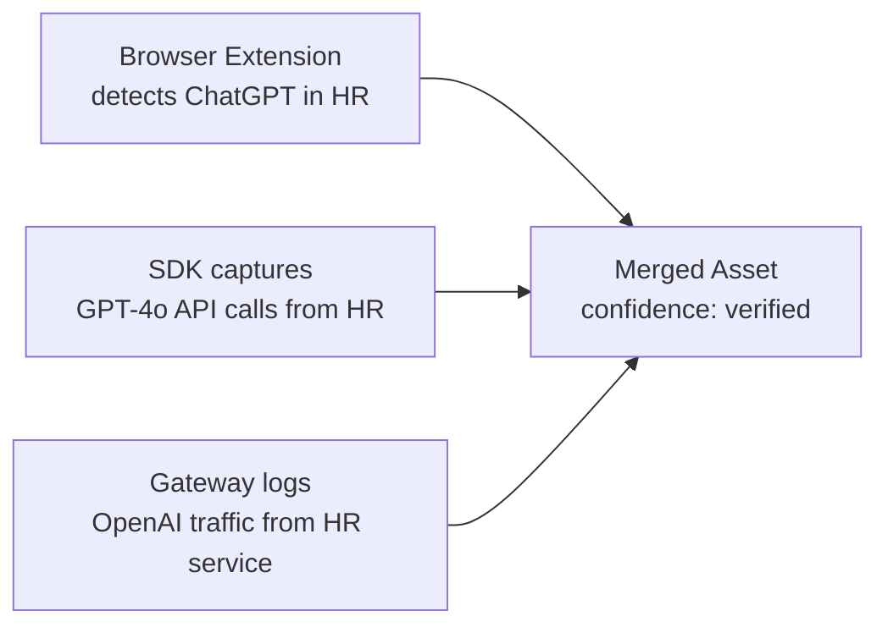

# Discovery Sources

Prompt Shields uses multiple independent channels to discover AI usage. When the same AI system is detected by multiple sources, confidence increases.

## Discovery Channels

| Source | What It Catches | How It Works |
|--------|----------------|--------------|
| **Browser Extension** | Shadow AI (ChatGPT, Gemini, Copilot in browser) | Chrome, Safari, Edge extensions monitor AI tool usage |
| **macOS App** | System-level AI tool usage | Accessibility-based tracking across all applications |
| **SDK** | Developer API calls with rich business context | Drop-in OpenAI wrapper captures metadata |
| **Gateway** | All LLM API traffic (zero code change) | Proxy intercepts and logs requests |
| **Platform Signal** | Enterprise platform audit logs | Pulls from Microsoft Purview, Defender, Azure |
| **OTel** (`otel`) | Apps already instrumented with OpenTelemetry GenAI | Collector OTLP/HTTP receiver maps `gen_ai.*` spans to usage events |
| **Code Scan** (`code_scan`) | AI SDKs, models and endpoints referenced in source, before they run | `ps-scan` CLI or GitHub Action scans the repository locally |
| **Survey** | Self-reported AI usage | Human Input Agent conducts interviews |

## Coverage Matrix

```
                     Browser  macOS   SDK    Gateway  Platform
Shadow AI              Yes     Yes     -       -        -
Developer API calls     -       -     Yes     Yes       -
CI/CD pipeline AI       -       -     Yes     Yes       -
Backend AI services     -       -     Yes     Yes       -
AI in internal tools   Yes     Yes     -      Yes       -
Platform audit logs     -       -      -       -       Yes
```

## Multi-Source Corroboration

When the same AI capability is detected by multiple sources, the system merges them into a single asset with multiple evidence trails:



The `discovery_source` field is an array showing all channels that detected this asset.

## Code Scan (`ps-scan`)

`ps-scan` is a console script of the Python SDK (`prompt-shields` package, `packages/sdk`). It reads a repository locally and reports LLM SDK imports, client constructors, model names, provider endpoints and API-key environment variable *names* in Python, TypeScript/JavaScript, Java/Kotlin, Go and config files. No source leaves the machine: findings carry only the matched identifier, a path and a line. `.env` files are never opened.

```bash
ps-scan .                                   # human summary
ps-scan . --format sarif -o ps-scan.sarif   # for code scanning
ps-scan . --format events > events.json     # body for POST /ingest/events (source="code_scan")
ps-scan . --exclude tests --exclude 'docs/*' --fail-on openai,env_var
```

`--exclude GLOB` (repeatable or comma-separated) skips files and directories whose path relative to the scan root, or whose name, matches. `--fail-on` takes finding kinds (`import`, `client`, `model`, `endpoint`, `env_var`), vendors, or `any`, and makes ps-scan exit `1` when a finding matches; the report is written first. ps-scan never uploads anything itself. Assets reported with `source: "code_scan"` get `medium` confidence until a runtime source (SDK, gateway, OTel) corroborates them.

### GitHub Action

The repository root is a composite action. It installs the SDK from the same ref, runs `ps-scan`, writes the summary to the job summary and, optionally, uploads SARIF to GitHub code scanning:

```yaml
jobs:
  ps-scan:
    runs-on: ubuntu-latest
    permissions:
      contents: read
      security-events: write   # only needed with upload-sarif: true
    steps:
      - uses: actions/checkout@v4
      - uses: Prompt-Shields/prompt-shields-sdk@main   # pin a tag or commit SHA
        with:
          exclude: |
            tests
            docs/*
          upload-sarif: true
          fail-on: ""            # e.g. "any" or "openai,env_var" to fail the job
```

| Input | Default | Meaning |
| --- | --- | --- |
| `path` | `.` | Directory to scan. SARIF paths are relative to it, so keep `.` when uploading SARIF and narrow with `exclude`. |
| `exclude` | | Globs, one per line or comma-separated. |
| `fail-on` | | Kinds, vendors or `any`; the job fails after the SARIF upload when one matches. |
| `sarif-file` | `ps-scan.sarif` | Where the SARIF report is written. |
| `upload-sarif` | `false` | Upload to code scanning (category `ps-scan`). |
| `python-version` | `3.12` | Python used to run ps-scan. |

Outputs: `sarif-file`, `findings` (count) and `failed` (`true` when `fail-on` matched).

## Cloud AI Inventory (Platform Signal)

Model deployments in your cloud accounts are AI assets whether or not their traffic is instrumented. The collector can read them, read-only, from the cloud control plane. Each deployment becomes an asset with `discovery_source: ["platform_signal"]` (`medium` confidence until another source corroborates it), its cloud `region` for sovereignty reporting, and `owner_email`, `environment` and `business_unit` taken from resource tags (`owner`, `env`/`environment`, `department`/`business_unit`; deployment tags override account tags). Tag values only fill empty fields, so owners curated in the registry are kept. `calling_service` is `azure:<deployment resource id>`, `aws:<Bedrock resource ARN>` or `gcp:<Vertex AI resource name>`.

Supported today: **Azure OpenAI and AI Foundry** (`OpenAI` and `AIServices` Cognitive Services accounts), **Amazon Bedrock** and **Google Vertex AI**.

### Azure: read-only service principal

Create an app registration with a client secret and assign it the built-in **Reader** role on each subscription to inventory, or this narrower custom role. Neither grants `listKeys`, so the principal cannot read account keys or call the models.

```json
{
  "Name": "Prompt Shields AI Inventory Reader",
  "IsCustom": true,
  "Actions": [
    "Microsoft.Resources/subscriptions/read",
    "Microsoft.CognitiveServices/accounts/read",
    "Microsoft.CognitiveServices/accounts/deployments/read"
  ],
  "NotActions": [],
  "AssignableScopes": ["/subscriptions/<subscription-id>"]
}
```

Credentials are operator configuration, per tenant, set in the collector's environment (never sent by tenants):

```bash
PS_CLOUD_INVENTORY='{"<tenant uuid>": {"azure": {
  "directory_id": "contoso.onmicrosoft.com",
  "client_id": "<app id>",
  "client_secret": "<secret>",
  "subscription_ids": ["<subscription id>"]
}}}'
```

Leave `subscription_ids` empty to inventory every subscription the principal can read. Run the inventory with `python -m collector.cloud_inventory --tenant <uuid>`, or `POST /api/v1/admin/cloud-inventory/pull` with `Authorization: Bearer $PS_ADMIN_TOKEN` and `{"tenant_id": "<uuid>"}`. Re-runs update the same assets. Deployments that disappear are not deleted; they go `stale` through the normal lifecycle sweep.

### AWS: Amazon Bedrock

Bedrock is regional, so list every region to inventory. In each region the collector records the resources that show AI in use, each as its own asset with vendor `amazon` (Azure deployments use `microsoft`):

| Resource | Why it is an asset | `model` |
| --- | --- | --- |
| Provisioned throughput | Dedicated, paid serving capacity | Foundation model id (or the custom model's base model) |
| Custom model (fine-tuned, continued pre-training, distilled) | A model trained on your data | Base model id |
| Imported model | Your own weights served by Bedrock | Imported model name |
| Application inference profile | Created to route and meter use of a model | Id of the profile's first model |

Failed or deleting resources are skipped. A provisioned custom model inherits the custom model's tags; its own tags win. System-defined (cross-region) inference profiles and the foundation-model catalog exist in every account whether or not they are used, so they are not recorded; on-demand use of a foundation model shows up through the SDK, the gateway or Bedrock invocation logs instead. Set `check_invocation_logging` to also report, per region, whether model invocation logging is enabled.

Minimal read-only IAM policy (these list actions do not support resource-level permissions). It grants no `bedrock:Invoke*`, so the principal cannot call models:

```json
{
  "Version": "2012-10-17",
  "Statement": [
    {
      "Sid": "PromptShieldsBedrockInventory",
      "Effect": "Allow",
      "Action": [
        "bedrock:ListProvisionedModelThroughputs",
        "bedrock:ListCustomModels",
        "bedrock:ListImportedModels",
        "bedrock:ListInferenceProfiles",
        "bedrock:ListTagsForResource"
      ],
      "Resource": "*"
    }
  ]
}
```

Add `bedrock:GetModelInvocationLoggingConfiguration` only if you set `check_invocation_logging`.

Attach the policy to an IAM user whose access keys you configure or, preferably, to a role in the inventoried account that those keys assume. With a role, the configured user needs only `sts:AssumeRole` on it, and the role's trust policy should require an external id:

```json
{
  "Version": "2012-10-17",
  "Statement": [
    {
      "Effect": "Allow",
      "Principal": {"AWS": "arn:aws:iam::<operator account id>:user/prompt-shields-inventory"},
      "Action": "sts:AssumeRole",
      "Condition": {"StringEquals": {"sts:ExternalId": "<external id>"}}
    }
  ]
}
```

Credentials are operator configuration in `PS_CLOUD_INVENTORY`, next to `azure`:

```bash
PS_CLOUD_INVENTORY='{"<tenant uuid>": {"aws": {
  "access_key_id": "<access key id>",
  "secret_access_key": "<secret>",
  "role_arn": "arn:aws:iam::<account id>:role/PromptShieldsInventory",
  "external_id": "<external id>",
  "regions": ["eu-central-1", "us-east-1"],
  "check_invocation_logging": false
}}}'
```

`role_arn` and `external_id` are optional; `session_token` is accepted for temporary keys. The collector never uses its own AWS environment, profiles or instance metadata. It signs requests itself (SigV4, no AWS SDK) and calls only `bedrock.<region>.amazonaws.com` and, to assume the role, `sts.<first region>.amazonaws.com`. Region names are validated strictly (commercial and GovCloud regions only). A region that fails is reported under `region_errors` and does not stop the others.

### Google Cloud: Vertex AI

Vertex AI is regional, so list every region to inventory, per project. In each project and region the collector records, each as its own asset with vendor `google`:

| Resource | Why it is an asset | `model` |
| --- | --- | --- |
| Model deployed to an endpoint (`…/endpoints/<id>/deployedModels/<id>`) | Serving capacity, the counterpart of an Azure deployment. Covers custom models, tuned models and **Model Garden** deployments of open or partner models | Base model of a tuned model, the Model Garden model id (for example `llama3_1`), else the Model Registry display name |
| Tuned model (`…/models/<id>`, from a succeeded tuning job) | Trained on your data, so recorded even when it is not deployed | Base model id (for example `gemini-2.0-flash-001`) |

A tuned model that is deployed is therefore two assets: the model and its deployment. Endpoints with nothing deployed, failed tuning jobs and registry models that are neither tuned nor deployed are not recorded. Serverless use of Google and partner models (Gemini, or Model-as-a-Service models such as Claude on Vertex AI) creates no resource in the project, so it shows up through the SDK, the gateway or audit logs instead.

Labels are read like tags: endpoint labels override the model's, and a tuned model's registry labels override its tuning job's. GCP label values cannot contain `@`, so an `owner` label never fills `owner_email`; set owners in the registry.

Create a service account with the predefined **Vertex AI Viewer** role (`roles/aiplatform.viewer`) on each project to inventory. It only grants `aiplatform.*.get` / `list` permissions (the inventory uses `aiplatform.endpoints.list`, `aiplatform.models.list` and `aiplatform.tuningJobs.list`) and no `aiplatform.endpoints.predict`, so the account cannot call models. Create a JSON key for it, and put the key file's content in the operator configuration:

```bash
gcloud projects add-iam-policy-binding <project id> \
  --member="serviceAccount:ps-inventory@<project id>.iam.gserviceaccount.com" \
  --role="roles/aiplatform.viewer"
```

```bash
PS_CLOUD_INVENTORY='{"<tenant uuid>": {"gcp": {
  "service_account": {"type": "service_account", "client_email": "...", "private_key": "...", ...},
  "project_ids": ["<project id>"],
  "regions": ["europe-west4", "us-central1"]
}}}'
```

`service_account` may also be the key file as a JSON string. Leave `project_ids` empty to inventory the service account's own project. The collector signs a JWT with the key and exchanges it at the fixed `oauth2.googleapis.com` (the key file's `token_uri` is ignored), then calls only `<region>-aiplatform.googleapis.com`. Region names are validated strictly (`us-central1`, `europe-west4`, …; not `global`). A project/region that fails, for example because the Vertex AI API is not enabled there, is reported under `region_errors` and does not stop the others.

## Provider Org Usage (Platform Signal)

The OpenAI organization usage API and the Anthropic Admin usage report list usage per project or workspace, API key and model, including keys nobody instrumented. The collector pulls them and turns each (project/workspace, key, model) into an asset with `discovery_source: ["platform_signal"]` (`medium` confidence until another source corroborates it) and `calling_service` `openai:project=<id>:key=<key id>` or `anthropic:workspace=<id>:key=<key id>`, with one usage event per day. Run it with `python -m collector.provider_usage_admin --tenant <uuid> [--days 7]` or `POST /api/v1/admin/provider-usage/pull` (`Authorization: Bearer $PS_ADMIN_TOKEN`, `{"tenant_id": "<uuid>"}`).

### Admin credentials (stored encrypted, write-only)

Use an OpenAI admin key and an Anthropic Admin API key, the most restricted the provider lets you create (read-only where offered). The collector only sends `GET` requests to the usage endpoints, but it cannot limit what the key itself allows. A tenant admin (tenant API key, `/api/v1/admin/...`) or a partner granted `provider-credentials:manage` (`/partner/v1/...`) stores them:

```bash
curl -X POST "$COLLECTOR/api/v1/admin/provider-credentials/openai" \
  -H "Authorization: Bearer $PS_TENANT_KEY" -H "Content-Type: application/json" \
  -d '{"admin_key": "sk-admin-..."}'
# 201 {"provider": "openai", "key_hint": "****wxyz", "key_id": "2026a",
#      "created_at": "...", "rotated_at": null}
```

| Route | |
|-------|---|
| `GET /provider-credentials` | Stored credentials (masked), and `meta.env_fallback`: providers still using `PS_PROVIDER_ADMIN_KEYS` |
| `GET /provider-credentials/{provider}` | One credential (masked) |
| `POST /provider-credentials/{provider}` | Store `{"admin_key": ...}` (`409` if one is stored) |
| `POST /provider-credentials/{provider}/rotate` | Replace the stored key |
| `DELETE /provider-credentials/{provider}` | Delete it |

`provider` is `openai` or `anthropic`. No response, log line or audit row returns the key: reads show the last four characters, the encryption key id and timestamps. The key is sealed with AES-256-GCM using the same `PS_WEBHOOK_SECRET_KEYS` keyring as webhook signing secrets, with its own derived key and bound to its row. Storing needs that keyring (`503` without it; the legacy single `PS_WEBHOOK_SECRET_KEY` is not used). After the active keyring key changes, a stored credential is re-encrypted with the new key the next time a pull uses it. Keep the old key in the keyring until every tenant has been pulled once. Credentials are tenant-scoped (row-level security) and deleted with the tenant on erasure.

`PS_PROVIDER_ADMIN_KEYS='{"<tenant uuid>": {"openai": "...", "anthropic": "..."}}'` in the collector's environment still works as a fallback for a provider with no stored credential. A stored credential that cannot be decrypted (its keyring key is missing) is reported as an error for that provider. The pull does not fall back to the environment in that case.

### Corroborating SDK sightings by key

The SDK sends `api_key_fingerprint`, the first 16 hex characters of `sha256(api key)`, never the key. The usage APIs report only an opaque key id (`key_...`, `apikey_...`). The providers' key-listing APIs add a redacted preview, but never the key or a hash of it. So the collector cannot compute the fingerprint from what the providers return, and it does not guess from previews. Register the link yourself, computing the fingerprint where the key already lives:

```bash
printf %s "$OPENAI_API_KEY" | sha256sum | cut -c1-16
curl -X PUT "$COLLECTOR/api/v1/admin/provider-key-fingerprints/openai/key_abc123" \
  -H "Authorization: Bearer $PS_TENANT_KEY" -H "Content-Type: application/json" \
  -d '{"api_key_fingerprint": "<16 hex>"}'
```

When an SDK event carried that fingerprint for the same vendor and model (the asset's model, or the event's requested or served model), the platform_signal asset for that key gains the SDK's source and the SDK asset gains `platform_signal`. Both become `verified`. This runs when a link is saved (`meta.corroborated_assets`) and after every usage pull (`corroborated_assets`). `GET /provider-key-fingerprints` lists links and `DELETE /provider-key-fingerprints/{provider}/{api_key_id}` removes one. Removing a link does not remove a source already recorded.

Limits:

- A fingerprint is only matched through a link you registered. A key with no link stays a `medium` shadow key even if the SDK uses it.
- Gateway events do not carry a fingerprint, so gateway sightings are not matched by key.
- Model names must match exactly. OpenAI often reports a dated snapshot (`gpt-4o-2024-08-06`), which the SDK's `served_model` usually matches.
- Bedrock and other AWS-credential calls have no API key to fingerprint.
