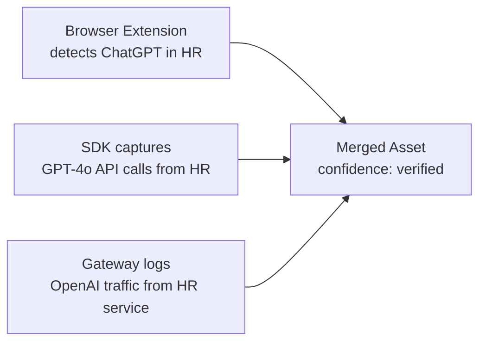

# Discovery Sources

Prompt Shields uses multiple independent channels to discover AI usage. When the same AI system is detected by multiple sources, confidence increases.

## Discovery Channels

| Source | What It Catches | How It Works |
|--------|----------------|--------------|
| **Browser Extension** | Shadow AI (ChatGPT, Gemini, Copilot in browser) | Chrome, Safari, Edge extensions monitor AI tool usage |
| **macOS App** | System-level AI tool usage | Accessibility-based tracking across all applications |
| **SDK** | Developer API calls with rich business context | Drop-in OpenAI wrapper captures metadata |
| **Gateway** | All LLM API traffic (zero code change) | Proxy intercepts and logs requests |
| **Platform Signal** | Enterprise platform audit logs | Pulls from Microsoft Purview, Defender, Azure |
| **Survey** | Self-reported AI usage | Human Input Agent conducts interviews |

## Coverage Matrix

```
                     Browser  macOS   SDK    Gateway  Platform
Shadow AI              Yes     Yes     -       -        -
Developer API calls     -       -     Yes     Yes       -
CI/CD pipeline AI       -       -     Yes     Yes       -
Backend AI services     -       -     Yes     Yes       -
AI in internal tools   Yes     Yes     -      Yes       -
Platform audit logs     -       -      -       -       Yes
```

## Multi-Source Corroboration

When the same AI capability is detected by multiple sources, the system merges them into a single asset with multiple evidence trails:



The `discovery_source` field is an array showing all channels that detected this asset.

## Cloud AI Inventory (Platform Signal)

Model deployments in your cloud accounts are AI assets whether or not their traffic is instrumented. The collector can read them, read-only, from the cloud control plane. Each deployment becomes an asset with `discovery_source: ["platform_signal"]` (`medium` confidence until another source corroborates it), its cloud `region` for sovereignty reporting, and `owner_email`, `environment` and `business_unit` taken from resource tags (`owner`, `env`/`environment`, `department`/`business_unit`; deployment tags override account tags). Tag values only fill empty fields, so owners curated in the registry are kept. `calling_service` is `azure:<deployment resource id>`.

Supported today: **Azure OpenAI and AI Foundry** (`OpenAI` and `AIServices` Cognitive Services accounts). AWS Bedrock and Google Vertex AI are planned.

### Azure: read-only service principal

Create an app registration with a client secret and assign it the built-in **Reader** role on each subscription to inventory, or this narrower custom role. Neither grants `listKeys`, so the principal cannot read account keys or call the models.

```json
{
  "Name": "Prompt Shields AI Inventory Reader",
  "IsCustom": true,
  "Actions": [
    "Microsoft.Resources/subscriptions/read",
    "Microsoft.CognitiveServices/accounts/read",
    "Microsoft.CognitiveServices/accounts/deployments/read"
  ],
  "NotActions": [],
  "AssignableScopes": ["/subscriptions/<subscription-id>"]
}
```

Credentials are operator configuration, per tenant, set in the collector's environment (never sent by tenants):

```bash
PS_CLOUD_INVENTORY='{"<tenant uuid>": {"azure": {
  "directory_id": "contoso.onmicrosoft.com",
  "client_id": "<app id>",
  "client_secret": "<secret>",
  "subscription_ids": ["<subscription id>"]
}}}'
```

Leave `subscription_ids` empty to inventory every subscription the principal can read. Run the inventory with `python -m collector.cloud_inventory --tenant <uuid>`, or `POST /api/v1/admin/cloud-inventory/pull` with `Authorization: Bearer $PS_ADMIN_TOKEN` and `{"tenant_id": "<uuid>"}`. Re-runs update the same assets. Deployments that disappear are not deleted; they go `stale` through the normal lifecycle sweep.
