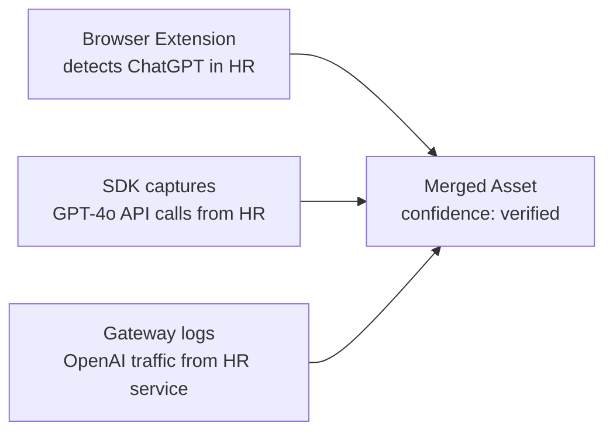

# Discovery Sources

Prompt Shields uses multiple independent channels to discover AI usage. When the same AI system is detected by multiple sources, confidence increases.

## Discovery Channels

| Source | What It Catches | How It Works |
|--------|----------------|--------------|
| **Browser Extension** | Shadow AI (ChatGPT, Gemini, Copilot in browser) | Chrome, Safari, Edge extensions monitor AI tool usage |
| **macOS App** | System-level AI tool usage | Accessibility-based tracking across all applications |
| **SDK** | Developer API calls with rich business context | Drop-in OpenAI wrapper captures metadata |
| **Gateway** | All LLM API traffic (zero code change) | Proxy intercepts and logs requests |
| **Platform Signal** | Enterprise platform audit logs | Pulls from Microsoft Purview, Defender, Azure |
| **OTel** (`otel`) | Apps already instrumented with OpenTelemetry GenAI | Collector OTLP/HTTP receiver (`/ingest/otel/v1/traces`, JSON or protobuf, so OpenLLMetry's default exporter works as is) maps `gen_ai.*` spans to usage events |
| **Kong** (`kong`) | LLM traffic through Kong AI Gateway (ai-proxy) | Kong's stock `http-log` plugin posts to `/ingest/kong`; see [Prompt Shields with Kong](/integrations/kong) |
| **MCP tool calls** | MCP servers and tools your services call | SDK `instrument()` wraps `mcp.ClientSession.call_tool`; MCP `tools/call` spans on the OTLP receiver. Names, counts and outcome only. Read with `GET /api/v1/registry/mcp-tools` |
| **Code Scan** (`code_scan`) | AI SDKs, models and endpoints referenced in source, before they run | `ps-scan` CLI or GitHub Action scans the repository locally |
| **Survey** | Self-reported AI usage | Human Input Agent conducts interviews |

## Coverage Matrix

```
                     Browser  macOS   SDK    Gateway  Platform
Shadow AI              Yes     Yes     -       -        -
Developer API calls     -       -     Yes     Yes       -
CI/CD pipeline AI       -       -     Yes     Yes       -
Backend AI services     -       -     Yes     Yes       -
AI in internal tools   Yes     Yes     -      Yes       -
Platform audit logs     -       -      -       -       Yes
```

## Multi-Source Corroboration

When the same AI capability is detected by multiple sources, the system merges them into a single asset with multiple evidence trails:



The `discovery_source` field is an array showing all channels that detected this asset.

## Code Scan (`ps-scan`)

`ps-scan` is a console script of the Python SDK (`prompt-shields` package, `packages/sdk`). It reads a repository locally and reports LLM SDK imports, client constructors, model names, provider endpoints and API-key environment variable *names* in Python, TypeScript/JavaScript, Java/Kotlin, Go and config files. No source leaves the machine: findings carry only the matched identifier, a path and a line. `.env` files are never opened.

```bash
ps-scan .                                   # human summary
ps-scan . --format sarif -o ps-scan.sarif   # for code scanning
ps-scan . --format events > events.json     # body for POST /ingest/events (source="code_scan")
ps-scan . --exclude tests --exclude 'docs/*' --fail-on openai,env_var
```

`--exclude GLOB` (repeatable or comma-separated) skips files and directories whose path relative to the scan root, or whose name, matches. `--fail-on` takes finding kinds (`import`, `client`, `model`, `endpoint`, `env_var`), vendors, or `any`, and makes ps-scan exit `1` when a finding matches; the report is written first. ps-scan never uploads anything itself. Assets reported with `source: "code_scan"` get `medium` confidence until a runtime source (SDK, gateway, OTel) corroborates them.

### GitHub Action

The repository root is a composite action. It installs the SDK from the same ref, runs `ps-scan`, writes the summary to the job summary and, optionally, uploads SARIF to GitHub code scanning:

```yaml
jobs:
  ps-scan:
    runs-on: ubuntu-latest
    permissions:
      contents: read
      security-events: write   # only needed with upload-sarif: true
    steps:
      - uses: actions/checkout@v5
      - uses: Prompt-Shields/prompt-shields-sdk@main   # pin a tag or commit SHA
        with:
          exclude: |
            tests
            docs/*
          upload-sarif: true
          fail-on: ""            # e.g. "any" or "openai,env_var" to fail the job
```

| Input | Default | Meaning |
| --- | --- | --- |
| `path` | `.` | Directory to scan. SARIF paths are relative to it, so keep `.` when uploading SARIF and narrow with `exclude`. |
| `exclude` | | Globs, one per line or comma-separated. |
| `fail-on` | | Kinds, vendors or `any`; the job fails after the SARIF upload when one matches. |
| `sarif-file` | `ps-scan.sarif` | Where the SARIF report is written. |
| `upload-sarif` | `false` | Upload to code scanning (category `ps-scan`). |
| `python-version` | `3.12` | Python used to run ps-scan. The action runs `actions/setup-python`, so later steps in the job see this interpreter as `python`. |

Outputs: `sarif-file`, `findings` (count) and `failed` (`true` when `fail-on` matched).

## MCP Tool Usage (observe only)

Which MCP servers and tools your services call, how often, and how often they fail. This is Phase 0 of the MCP plan in `gateway/docs/mcp-tool-call-discovery.md`: it observes calls and never alters them: a tool call's result or exception is unchanged. The SDK only buffers each call's event on the call path and posts batches from a background thread (every 2 s or 100 events, plus a bounded flush at exit), so a slow or unreachable collector does not delay `call_tool`; `PS_MCP_TELEMETRY_MODE=sync` posts each event before `call_tool` returns instead.

Two writers feed one aggregate table, `mcp_tool_usage` (one row per tenant, source, server, tool, calling service, environment and, from the gateway with OIDC, user, with call, error and blocked counts, mean latency, first and last seen):

- **SDK**: `instrument()` wraps `mcp.ClientSession.call_tool` and posts to `POST /ingest/mcp` (see the Python SDK guide). Any client with a tenant ingest key can post there too:

  ```bash
  curl -X POST $COLLECTOR/ingest/mcp -H "Authorization: Bearer $PS_API_KEY" \
    -d '{"events": [{"server_name": "github", "tool_name": "create_issue",
                     "outcome": "ok", "latency_ms": 41, "calling_service": "billing-agent"}]}'
  # {"ingested": 1, "skipped": 0}
  ```

  `tool_name` is required. `outcome` is `ok` (default), `error` or `blocked` (refused by a guardrail; counted in `blocked_count`, not as an error), `source` is `sdk` (default), `gateway` or `scan`. `user_id` (a hex hash of 16 to 64 characters, e.g. the gateway's OIDC subject hash) and `user_group` (`[A-Za-z0-9_.:-]`, up to 64 characters) attribute the call; any other value is dropped, so a raw user id or an email address is never stored. Other fields are ignored, so arguments and results are never stored. Names longer than 200 characters are refused, not cut, and a URL given as `server_name` is reduced to its host. An event that cannot be stored is skipped and counted in `skipped`; the rest of the batch is kept. A request holds at most 1,000 events and 1 MiB, or gets `413`. Same auth as `/ingest/events`, with its own per-tenant rate limit, `PS_MCP_RATE_LIMIT_PER_MINUTE` (default 600 requests/minute, `0` turns it off), so MCP telemetry cannot use up the LLM telemetry budget.
- **OTel**: the OTLP receiver (`/ingest/otel/v1/traces`) stores MCP `tools/call` spans (OTel MCP semantic conventions) as `source: "otel"`: the tool from `gen_ai.tool.name` (or the span name), the server from `server.address` on client spans or the server's own `service.name` on server spans, an error from span status `ERROR` or `error.type`, and the transport from `network.transport` / `network.protocol.name`. `gen_ai.tool.call.arguments` and `.result` are dropped like all content. Other MCP methods (`tools/list`, `initialize`, ...) are not stored. If both a client and its server export spans, the call is counted once under each identity.

Read the tenant's servers and tools with `GET /api/v1/registry/mcp-tools` (tenant API key; filters `server_name`, `source`, `limit`). Server and tool names come from MCP servers and apps: escape them when rendering and never put them in an LLM prompt. The Partner API does not expose MCP usage yet; that comes with the MCP server registry (Phase 2). Rows follow the tenant's retention period and are removed on erasure (see Data Retention).

## Cloud AI Inventory (Platform Signal)

Model deployments in your cloud accounts are AI assets whether or not their traffic is instrumented. The collector can read them, read-only, from the cloud control plane. Each deployment becomes an asset with `discovery_source: ["platform_signal"]` (`medium` confidence until another source corroborates it), its cloud `region` for sovereignty reporting, and `owner_email`, `environment` and `business_unit` taken from resource tags (`owner`, `env`/`environment`, `department`/`business_unit`; deployment tags override account tags). Tag values only fill empty fields, so owners curated in the registry are kept. `calling_service` is `azure:<deployment resource id>`, `aws:<Bedrock resource ARN>` or `gcp:<Vertex AI resource name>`.

Supported today: **Azure OpenAI and AI Foundry** (`OpenAI` and `AIServices` Cognitive Services accounts, and serverless and managed online endpoints in Azure Machine Learning workspaces and hub-based AI Foundry projects), **Amazon Bedrock** and **Google Vertex AI**.

### Azure: read-only service principal

Create an app registration with a client secret and assign it the built-in **Reader** role on each subscription to inventory, or this narrower custom role. Neither grants `listKeys` (or the endpoints' `listKeys`/`token` actions), so the principal cannot read keys or call the models.

```json
{
  "Name": "Prompt Shields AI Inventory Reader",
  "IsCustom": true,
  "Actions": [
    "Microsoft.Resources/subscriptions/read",
    "Microsoft.CognitiveServices/accounts/read",
    "Microsoft.CognitiveServices/accounts/deployments/read",
    "Microsoft.MachineLearningServices/workspaces/read",
    "Microsoft.MachineLearningServices/workspaces/serverlessEndpoints/read",
    "Microsoft.MachineLearningServices/workspaces/onlineEndpoints/read",
    "Microsoft.MachineLearningServices/workspaces/onlineEndpoints/deployments/read"
  ],
  "NotActions": [],
  "AssignableScopes": ["/subscriptions/<subscription-id>"]
}
```

Credentials are operator configuration, per tenant, set in the collector's environment (never sent by tenants):

```bash
PS_CLOUD_INVENTORY='{"<tenant uuid>": {"azure": {
  "directory_id": "contoso.onmicrosoft.com",
  "client_id": "<app id>",
  "client_secret": "<secret>",
  "subscription_ids": ["<subscription id>"]
}}}'
```

In each subscription the collector records, as assets with vendor `microsoft`:

| Resource | Model recorded |
| --- | --- |
| Deployment in an `OpenAI` or `AIServices` (AI Foundry) account | The deployed model (`gpt-4o`, …) |
| Serverless API endpoint (Model-as-a-Service) in an Azure Machine Learning workspace or a hub-based AI Foundry project | The catalog model (for example `Meta-Llama-3.1-70B-Instruct` from `azureml://registries/azureml-meta/models/…`) |
| Managed online endpoint deployment in such a workspace or project | The deployed model's name |

Hubs (whose deployments live in their projects) and feature stores are skipped, as are failed, deleting and suspended endpoints. An endpoint's region is its own location, else its workspace's; tags are read workspace, then endpoint, then deployment, the later overriding the earlier. Set `"include_ml_workspaces": false` to skip Machine Learning workspaces. A principal that lacks the `Microsoft.MachineLearningServices` permissions (for example the custom role above without its last four actions) still gets its account deployments: the refusal is reported under `ml_errors`, by subscription or workspace, apart from `subscription_errors`. A subscription where the Machine Learning resource provider is not registered has no workspaces and reports no error.

Leave `subscription_ids` empty to inventory every subscription the principal can read. Run the inventory with `python -m collector.cloud_inventory --tenant <uuid>`, or `POST /api/v1/admin/cloud-inventory/pull` with `Authorization: Bearer $PS_ADMIN_TOKEN` and `{"tenant_id": "<uuid>"}`. Re-runs update the same assets. Deployments that disappear are not deleted; they go `stale` through the normal lifecycle sweep. The ARM access token is renewed five minutes before it expires, and also when ARM rejects it with 401 before that time (for example after the token is revoked, or after the host was suspended). In that case the collector gets a new token and retries the rejected page once, so a long run does not fail part-way.

#### Azure offline import (no credentials in the collector)

As for [AWS](#offline-import-no-credentials-in-the-collector), someone already signed in with `az login` (Reader, or the custom role above, is enough) can export the inventory and import the file; the collector then makes no Azure call and holds no secret:

```bash
# Read-only: runs only `az ... list` commands with your az login.
# No subscription ids: every enabled subscription your login can see.
scripts/cloud-inventory-export-azure.sh <subscription id> [...] > azure-export.json
python -m collector.cloud_inventory_import --tenant <tenant uuid> --file azure-export.json
```

The script calls `az cognitiveservices account list`, `az cognitiveservices account deployment list` for each `OpenAI`/`AIServices` account, `az resource list --resource-type Microsoft.MachineLearningServices/workspaces`, and `az ml serverless-endpoint list`, `az ml online-endpoint list` and `az ml online-deployment list` for each workspace (with the Azure CLI `ml` extension; `PS_EXPORT_SKIP_ML=1` leaves Machine Learning out). It never lists keys or endpoint credentials, and keeps only the fields the import reads (ids, names, kind, location, tags, provisioning state, model), so endpoint URLs, environment variables and identities stay in your shell. The export, which the import route and command take like the AWS one:

```json
{
  "cloud": "azure",
  "subscriptions": {
    "<subscription id>": {
      "accounts":      [...],
      "deployments":   {"<account resource id>": [...]},
      "ml_workspaces": [...],
      "ml_endpoints":  {"<workspace resource id>": {
        "serverless_endpoints": [...],
        "online_endpoints":     [...],
        "online_deployments":   {"<endpoint name>": [...]}
      }}
    }
  }
}
```

Each listing may also be the raw CLI output or ARM's `{"value": [...]}`; both the `az ml` shape (`provisioning_state`, `model_id`) and the ARM shape (`properties.provisioningState`, …) are read. The pull's rules and asset ids apply, so an import and a later pull update the same assets. Resources whose id names another subscription are skipped (`skipped_other_subscription`); accounts, workspaces and online endpoints without their listing in the export are counted (`accounts_without_deployment_listing`, …) rather than guessed. Credential-named fields (`accessToken`, `key1`/`key2` from `az cognitiveservices account keys list`, `primaryKey` from `get-credentials`, `clientSecret`, `connectionString`, …) make the import refuse the whole export with a 400 that names the field, never its value.

### AWS: Amazon Bedrock

Bedrock is regional, so list every region to inventory. In each region the collector records the resources that show AI in use, each as its own asset with vendor `amazon` (Azure deployments use `microsoft`):

| Resource | Why it is an asset | `model` |
| --- | --- | --- |
| Provisioned throughput | Dedicated, paid serving capacity | Foundation model id (or the custom model's base model) |
| Custom model (fine-tuned, continued pre-training, distilled) | A model trained on your data | Base model id |
| Imported model | Your own weights served by Bedrock | Imported model name |
| Application inference profile | Created to route and meter use of a model | Id of the profile's first model |

Failed or deleting resources are skipped. A provisioned custom model inherits the custom model's tags; its own tags win. System-defined (cross-region) inference profiles and the foundation-model catalog exist in every account whether or not they are used, so they are not recorded; on-demand use of a foundation model shows up through the SDK, the gateway or Bedrock invocation logs instead. Set `check_invocation_logging` to also report, per region, whether model invocation logging is enabled.

Set `check_model_access` to also report, per region, which foundation models the account can invoke and which system-defined (cross-region or global) inference profiles it can use. This is reported in the pull result under `model_access`, not stored as assets, because access is not use. Each profile lists the regions it routes requests to, which matters for sovereignty: a `eu.` profile called in `eu-central-1` may be served from `eu-west-3`. Only models invocable on demand or through an inference profile are checked (provisioned throughput is inventoried above), one `GetFoundationModelAvailability` read per model per region. Models that are accessible but whose Marketplace agreement is not yet accepted are also listed under `agreement_not_accepted`. If the check fails in a region (for example, a missing permission), the error is reported under `model_access_errors`, and that region's assets are still recorded.

```json
"model_access": {"eu-central-1": {
  "foundation_models": ["anthropic.claude-3-haiku-20240307-v1:0"],
  "inference_profiles": {"eu.anthropic.claude-3-haiku-20240307-v1:0": ["eu-central-1", "eu-west-1", "eu-west-3"]}
}}
```

Minimal read-only IAM policy (these list actions do not support resource-level permissions). It grants no `bedrock:Invoke*`, so the principal cannot call models:

```json
{
  "Version": "2012-10-17",
  "Statement": [
    {
      "Sid": "PromptShieldsBedrockInventory",
      "Effect": "Allow",
      "Action": [
        "bedrock:ListProvisionedModelThroughputs",
        "bedrock:ListCustomModels",
        "bedrock:ListImportedModels",
        "bedrock:ListInferenceProfiles",
        "bedrock:ListTagsForResource"
      ],
      "Resource": "*"
    }
  ]
}
```

Add `bedrock:GetModelInvocationLoggingConfiguration` only if you set `check_invocation_logging`, and `bedrock:ListFoundationModels` and `bedrock:GetFoundationModelAvailability` only if you set `check_model_access`.

Attach the policy to an IAM user whose access keys you configure or, preferably, to a role in the inventoried account that those keys assume. With a role, the configured user needs only `sts:AssumeRole` on it, and the role's trust policy should require an external id:

```json
{
  "Version": "2012-10-17",
  "Statement": [
    {
      "Effect": "Allow",
      "Principal": {"AWS": "arn:aws:iam::<operator account id>:user/prompt-shields-inventory"},
      "Action": "sts:AssumeRole",
      "Condition": {"StringEquals": {"sts:ExternalId": "<external id>"}}
    }
  ]
}
```

Credentials are operator configuration in `PS_CLOUD_INVENTORY`, next to `azure`:

```bash
PS_CLOUD_INVENTORY='{"<tenant uuid>": {"aws": {
  "access_key_id": "<access key id>",
  "secret_access_key": "<secret>",
  "role_arn": "arn:aws:iam::<account id>:role/PromptShieldsInventory",
  "external_id": "<external id>",
  "regions": ["eu-central-1", "us-east-1"],
  "check_invocation_logging": false,
  "check_model_access": false
}}}'
```

`role_arn` and `external_id` are optional; `session_token` is accepted for temporary keys. The collector never uses its own AWS environment, profiles or instance metadata. It signs requests itself (SigV4, no AWS SDK) and calls only `bedrock.<region>.amazonaws.com` and, to assume the role, `sts.<first region>.amazonaws.com`. Region names are validated strictly (commercial and GovCloud regions only). A region that fails is reported under `region_errors` and does not stop the others.

#### Offline import (no credentials in the collector)

If the collector may not hold any cloud credential, even a read-only one, someone who already has read access can export the inventory with the AWS CLI and import the file. The collector then makes no AWS call and never sees a credential. The export needs the same five `bedrock:List*` actions as the policy above (plus `sts:GetCallerIdentity`, which every principal has, unless `AWS_ACCOUNT_ID` is set):

```bash
# Read-only: runs only `aws bedrock list-*` with the credentials in your shell.
scripts/cloud-inventory-export-aws.sh eu-central-1 us-east-1 > bedrock-export.json

# Then, on the collector host:
python -m collector.cloud_inventory_import --tenant <tenant uuid> --file bedrock-export.json
# or
curl -X POST "$COLLECTOR/api/v1/admin/cloud-inventory/import" \
  -H "Authorization: Bearer $PS_ADMIN_TOKEN" -H "Content-Type: application/json" \
  -d "{\"tenant_id\": \"<tenant uuid>\", \"export\": $(cat bedrock-export.json)}"
```

The export is the CLI's JSON output, unchanged, per region:

```json
{
  "cloud": "aws",
  "account_id": "123456789012",
  "regions": {
    "eu-central-1": {
      "custom_models":           {"modelSummaries": [...]},
      "imported_models":         {"modelSummaries": [...]},
      "provisioned_throughputs": {"provisionedModelSummaries": [...]},
      "inference_profiles":      {"inferenceProfileSummaries": [...]},
      "tags": {"<resource ARN>": {"tags": [{"key": "owner", "value": "..."}]}}
    }
  }
}
```

Any listing may be left out, or given as its bare list of items. The same rules as the pull decide what becomes an asset, and the asset ids are the same, so an import and a later pull update the same rows. With `account_id`, resources whose ARN names another account are skipped and counted under `skipped_other_account`. Resources without a `tags` entry are counted under `resources_without_tags`; their owner stays empty. An export that contains a field named like a credential (`SecretAccessKey`, `SessionToken`, `aws_secret_access_key`, `Credentials`, `password`, …), for example pasted `aws sts assume-role` output, is refused with a 400. The error names the field but never its value. The export is never logged.

### Google Cloud: Vertex AI

Vertex AI is regional, so list every region to inventory, per project. In each project and region the collector records, each as its own asset with vendor `google`:

| Resource | Why it is an asset | `model` |
| --- | --- | --- |
| Model deployed to an endpoint (`…/endpoints/<id>/deployedModels/<id>`) | Serving capacity, the counterpart of an Azure deployment. Covers custom models, tuned models and **Model Garden** deployments of open or partner models | Base model of a tuned model, the Model Garden model id (for example `llama3_1`), else the Model Registry display name |
| Tuned model (`…/models/<id>`, from a succeeded tuning job) | Trained on your data, so recorded even when it is not deployed | Base model id (for example `gemini-2.0-flash-001`) |

A tuned model that is deployed is therefore two assets: the model and its deployment. Endpoints with nothing deployed, failed tuning jobs and registry models that are neither tuned nor deployed are not recorded. Serverless use of Google and partner models (Gemini, or Model-as-a-Service models such as Claude on Vertex AI) creates no resource in the project, so it shows up through the SDK, the gateway or audit logs instead.

Labels are read like tags: endpoint labels override the model's, and a tuned model's registry labels override its tuning job's. GCP label values cannot contain `@`, so an `owner` label fills `owner_email` only through `owner_label_emails` in the operator configuration, which maps label values to email addresses (for example `{"claims-team": "claims-ai@acme.com"}`). Owner labels without a mapping are ignored; set those owners in the registry.

Create a service account with the predefined **Vertex AI Viewer** role (`roles/aiplatform.viewer`) on each project to inventory. It only grants `aiplatform.*.get` / `list` permissions (the inventory uses `aiplatform.endpoints.list`, `aiplatform.models.list` and `aiplatform.tuningJobs.list`) and no `aiplatform.endpoints.predict`, so the account cannot call models. Create a JSON key for it, and put the key file's content in the operator configuration:

```bash
gcloud projects add-iam-policy-binding <project id> \
  --member="serviceAccount:ps-inventory@<project id>.iam.gserviceaccount.com" \
  --role="roles/aiplatform.viewer"
```

```bash
PS_CLOUD_INVENTORY='{"<tenant uuid>": {"gcp": {
  "service_account": {"type": "service_account", "client_email": "...", "private_key": "...", ...},
  "project_ids": ["<project id>"],
  "regions": ["europe-west4", "us-central1"],
  "owner_label_emails": {"claims-team": "claims-ai@acme.com"}
}}}'
```

`service_account` may also be the key file as a JSON string. Leave `project_ids` empty to inventory the service account's own project. The collector signs a JWT with the key and exchanges it at the fixed `oauth2.googleapis.com` (the key file's `token_uri` is ignored), then calls only `<region>-aiplatform.googleapis.com`. Region names are validated strictly (`us-central1`, `europe-west4`, …; not `global`). A project/region that fails, for example because the Vertex AI API is not enabled there, is reported under `region_errors` and does not stop the others.

#### Vertex AI offline import (no credentials in the collector)

With no service account key in the collector, someone signed in with `gcloud auth login` (Vertex AI Viewer is enough) can export the inventory and import the file; the collector makes no Google Cloud call:

```bash
# Read-only: runs only `gcloud ai endpoints list` and `gcloud ai models list`.
scripts/cloud-inventory-export-gcp.sh <project id>[,<project id>...] europe-west4 us-central1 > vertex-export.json
python -m collector.cloud_inventory_import --tenant <tenant uuid> --file vertex-export.json
```

The script keeps only the fields the import reads (names, display names, labels, deployed model ids and models, the Model Garden source). The export:

```json
{
  "cloud": "gcp",
  "owner_label_emails": {"claims-team": "claims-ai@acme.com"},
  "projects": {
    "<project id>": {
      "europe-west4": {"endpoints": [...], "models": [...], "tuning_jobs": [...]}
    }
  }
}
```

Add `owner_label_emails` by hand if you use owner labels; it works as in the pull configuration. Each listing may also be the REST output (`{"endpoints": [...]}`). The pull's rules and asset ids apply, so an import and a later pull update the same assets. Two differences, because gcloud has no list command for them: tuning jobs are not exported, so tuned models that are not deployed are missing and a deployed tuned model is named by its registry display name (an optional `tuning_jobs` listing from the REST API `tuningJobs.list` fills this in); and a deployed model registered in a region that is not in the export keeps its deployment's display name, counted under `models_in_unexported_regions`. The next pull, if one ever runs, corrects both on the same assets. Credential-named fields (`private_key`, `access_token`, `refresh_token`, …) are refused as for the other clouds.

## Provider Org Usage (Platform Signal)

The OpenAI organization usage API and the Anthropic Admin usage report list usage per project or workspace, API key and model, including keys nobody instrumented. The collector pulls them and turns each (project/workspace, key, model) into an asset with `discovery_source: ["platform_signal"]` (`medium` confidence until another source corroborates it) and `calling_service` `openai:project=<id>:key=<key id>` or `anthropic:workspace=<id>:key=<key id>`, with one usage event per day. Run it with `python -m collector.provider_usage_admin --tenant <uuid> [--days 7]` or `POST /api/v1/admin/provider-usage/pull` (`Authorization: Bearer $PS_ADMIN_TOKEN`, `{"tenant_id": "<uuid>"}`).

### Scheduling the pull

To pull every tenant that has a stored credential or a `PS_PROVIDER_ADMIN_KEYS` entry, use one of these:

- **In process.** Set `PS_PROVIDER_USAGE_PULL_INTERVAL_SECONDS=86400` (daily) on **one** collector replica. Each run covers the last `PS_PROVIDER_USAGE_PULL_DAYS` days (default 3), so a bucket the provider finalises late, or a missed run, is picked up next time. The schedule is off by default (`0`). It calls the providers' admin APIs with tenants' keys, so an operator should opt in. Values under 3600 are refused, because usage is reported in daily buckets.
- **Cron or a Kubernetes CronJob.** Run `python -m collector.provider_usage_admin --all-tenants [--days 3]` once a day, for example `15 2 * * *`. Add `--loop --interval 86400` to keep a single worker running instead.

The collector lists the tenants through a logged row-level-security bypass (`provider-usage-schedule`). It then pulls each tenant in its own session, under that tenant's RLS context. A tenant that fails is reported and does not stop the others. Pulls are idempotent, so overlapping windows overwrite the same rows. A run holds a PostgreSQL advisory lock: a replica or CLI run that starts while another is in progress skips that run.

### Admin credentials (stored encrypted, write-only)

Use an OpenAI admin key and an Anthropic Admin API key, the most restricted the provider lets you create (read-only where offered). The collector only sends `GET` requests to the usage endpoints, but it cannot limit what the key itself allows. A tenant admin (tenant API key, `/api/v1/admin/...`) or a partner granted `provider-credentials:manage` (`/partner/v1/...`) stores them:

```bash
curl -X POST "$COLLECTOR/api/v1/admin/provider-credentials/openai" \
  -H "Authorization: Bearer $PS_TENANT_KEY" -H "Content-Type: application/json" \
  -d '{"admin_key": "sk-admin-..."}'
# 201 {"provider": "openai", "key_hint": "****wxyz", "key_id": "2026a",
#      "created_at": "...", "rotated_at": null}
```

| Route | |
|-------|---|
| `GET /provider-credentials` | Stored credentials (masked), and `meta.env_fallback`: providers still using `PS_PROVIDER_ADMIN_KEYS` |
| `GET /provider-credentials/{provider}` | One credential (masked) |
| `POST /provider-credentials/{provider}` | Store `{"admin_key": ...}` (`409` if one is stored) |
| `POST /provider-credentials/{provider}/rotate` | Replace the stored key |
| `DELETE /provider-credentials/{provider}` | Delete it |

`provider` is `openai` or `anthropic`. No response, log line or audit row returns the key: reads show the last four characters, the encryption key id and timestamps. The key is sealed with AES-256-GCM using the same `PS_WEBHOOK_SECRET_KEYS` keyring as webhook signing secrets, with its own derived key and bound to its tenant, provider and row. Storing needs that keyring (`503` without it; the legacy single `PS_WEBHOOK_SECRET_KEY` is not used). After the active keyring key changes, a stored credential is re-encrypted with the new key the next time a pull uses it. Keep the old key in the keyring until every tenant has been pulled once. Credentials are tenant-scoped (row-level security) and deleted with the tenant on erasure.

`PS_PROVIDER_ADMIN_KEYS='{"<tenant uuid>": {"openai": "...", "anthropic": "..."}}'` in the collector's environment still works as a fallback for a provider with no stored credential. A stored credential that cannot be decrypted (its keyring key is missing) is reported as an error for that provider. The pull does not fall back to the environment in that case.

### Corroborating SDK sightings by key

The SDK sends `api_key_fingerprint`, the first 16 hex characters of `sha256(api key)`, never the key. The usage APIs report only an opaque key id (`key_...`, `apikey_...`). The providers' key-listing APIs add a redacted preview, but never the key or a hash of it. So the collector cannot compute the fingerprint from what the providers return, and it does not guess from previews. Register the link yourself, computing the fingerprint where the key already lives:

```bash
printf %s "$OPENAI_API_KEY" | sha256sum | cut -c1-16
curl -X PUT "$COLLECTOR/api/v1/admin/provider-key-fingerprints/openai/key_abc123" \
  -H "Authorization: Bearer $PS_TENANT_KEY" -H "Content-Type: application/json" \
  -d '{"api_key_fingerprint": "<16 hex>"}'
```

When an SDK event carried that fingerprint for the same vendor and model (the asset's model, or the event's requested or served model), the platform_signal asset for that key gains the SDK's source and the SDK asset gains `platform_signal`. Both become `verified`. This runs when a link is saved (`meta.corroborated_assets`) and after every usage pull (`corroborated_assets`). `GET /provider-key-fingerprints` lists links and `DELETE /provider-key-fingerprints/{provider}/{api_key_id}` removes one. Removing a link does not remove a source already recorded.

Limits:

- A fingerprint is only matched through a link you registered. A key with no link stays a `medium` shadow key even if the SDK uses it.
- Gateway events carry a fingerprint only when the gateway sets `PS_TELEMETRY_CREDENTIAL_FINGERPRINT=true`; it is computed the same way as the SDK's.
- Model names must match exactly. OpenAI often reports a dated snapshot (`gpt-4o-2024-08-06`), which the SDK's `served_model` usually matches.
- Bedrock and other AWS-credential calls have no API key to fingerprint.

#### Keyless auth: a stable fingerprint

With keyless auth (OAuth client credentials, workload identity federation, cloud role credentials) the credential is a short-lived token, so `sha256(token)` changes at every rotation. Opt in to an identity fingerprint instead: `prompt_shields.credentials` hashes the identity the token belongs to (`sha256("<kind>\n<id>...")[:16]`), exactly as the gateway does, and the value survives token rotation. Pass it as `credential_fingerprint=` to a client or `instrument()`, or set `PS_CREDENTIAL_FINGERPRINT`. Without it nothing changes.

```python
from prompt_shields import ShieldsAnthropic
from prompt_shields.credentials import anthropic_workload_fingerprint_from_env

# The Anthropic SDK federates from ANTHROPIC_FEDERATION_RULE_ID, ..._IDENTITY_TOKEN_FILE etc.
client = ShieldsAnthropic(api_key=None, ps_api_key="ps-...",
                          credential_fingerprint=anthropic_workload_fingerprint_from_env())
```

Helpers: `oauth_client_fingerprint(token_url, client_id)`, `openai_workload_fingerprint(service_account_id)`, `anthropic_workload_fingerprint(organization_id, service_account_id)`, `aws_role_fingerprint`, `aws_key_fingerprint`, `azure_entra_fingerprint`, `azure_managed_fingerprint`, `azure_workload_fingerprint`, `gcp_service_account_fingerprint`. An identity fingerprint never matches a provider key link (those are key hashes); it groups one workload's calls across SDK and gateway.
