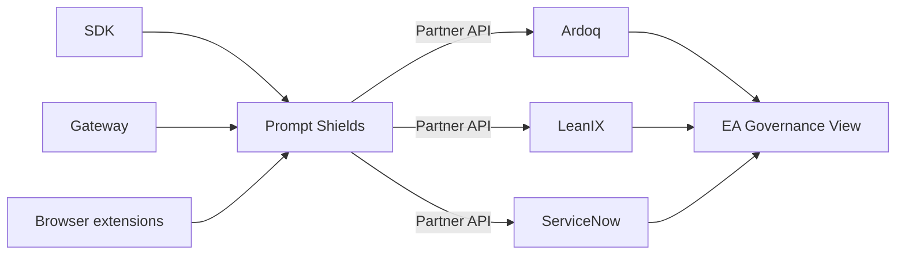

# Find every AI system your organisation runs

Prompt Shields discovers AI usage across your entire organisation — from developers calling LLM APIs in code, to employees using ChatGPT in the browser, to AI embedded in enterprise tools — and turns it into one deduplicated register of AI assets. The Partner API gives Enterprise Architecture platforms structured access to that register.

<CardGroup cols={3}>
  <Card title="Quickstart" icon="rocket" href="/quickstart">
    Your first Partner API call in five minutes
  </Card>
  <Card title="Python SDK" icon="python" href="/sdks/python">
    Swap `OpenAI` for `ShieldsOpenAI` and every call reports itself
  </Card>
  <Card title="API reference" icon="code" href="/api-reference/overview">
    Assets, taxonomy, delta sync and bulk export
  </Card>
</CardGroup>

## Two ways to instrument your code

<Tabs>
  <Tab title="Python SDK">
    A drop-in wrapper around the OpenAI and Anthropic clients. Use it when you can change the call site and want business context on every event.

    ```python
    from prompt_shields import ShieldsOpenAI

    client = ShieldsOpenAI(
        api_key="sk-...",
        ps_api_key="ps-...",
        business_unit="HR",
        use_case="interview-screening",
        owner="jane.doe@acme.com",
        data_classification="confidential",
    )

    client.chat.completions.create(
        model="gpt-4o",
        messages=[{"role": "user", "content": "..."}],
    )
    ```
  </Tab>
  <Tab title="AI Gateway">
    An OpenAI-compatible proxy. Use it when you cannot, or would rather not, modify the application.

    ```bash
    export OPENAI_BASE_URL=http://localhost:8787/v1
    ```

    Add business context with optional request headers:

    ```
    X-PS-Business-Unit: HR
    X-PS-Use-Case: interview-screening
    X-PS-Owner: jane.doe@acme.com
    ```
  </Tab>
</Tabs>

Both are fail-open: if the collector is unreachable, the model call still goes through.

## What Prompt Shields discovers

<CardGroup cols={2}>
  <Card title="Shadow AI" icon="ghost" href="/guides/discovery-sources">
    Browser extensions detect ChatGPT, Gemini, Copilot usage across Chrome, Safari, and Edge
  </Card>
  <Card title="Developer AI" icon="code" href="/guides/discovery-sources">
    SDK and gateway proxy capture every LLM API call routed through them
  </Card>
  <Card title="Data Flows" icon="diagram-project" href="/guides/data-flows">
    Track which systems feed data into AI and where outputs go
  </Card>
  <Card title="Risk Mapping" icon="shield-halved" href="/guides/risk-frameworks">
    Map each AI asset to NIST AI RMF, ISO 42001, and EU AI Act frameworks
  </Card>
</CardGroup>

## How partners use this API

The Partner API is designed for **Enterprise Architecture tools** that need to incorporate AI asset data into their governance platforms.



<Steps>
  <Step title="Authenticate">
    Your EA tool authenticates via OAuth 2.0 or API key.
  </Step>
  <Step title="Initial sync">
    Pull the full register with `GET /partner/v1/export`.
  </Step>
  <Step title="Stay current">
    Poll `GET /partner/v1/changes?since={last_sync}` for deltas.
  </Step>
  <Step title="Map to your metamodel">
    Map AI assets to components, relationships and capabilities.
  </Step>
</Steps>

## Key concepts

| Concept | Description |
|---------|-------------|
| **[AI Asset](/guides/ai-asset-registry)** | A discovered AI use case (e.g., "HR using GPT-4o for interview screening") |
| **[Discovery Source](/guides/discovery-sources)** | How the asset was found (SDK, gateway, browser extension, platform signal) |
| **[Confidence](/guides/confidence-scoring)** | How many independent sources corroborate the asset, from `low` to `verified` |
| **[Data Flow](/guides/data-flows)** | Input/output data lineage for an AI asset |
| **[Risk Mapping](/guides/risk-frameworks)** | Risk assessment linked to a governance framework |

<Note>
  Prompt Shields is a discovery and inventory tool. It observes AI usage; it does not block, filter or rewrite prompts. Confidence counts automated sources — `verified` does not mean a person reviewed the asset.
</Note>

<Card title="Ready to integrate?" icon="rocket" href="/quickstart">
  Follow the quickstart guide to get your first API call working in 5 minutes
</Card>
